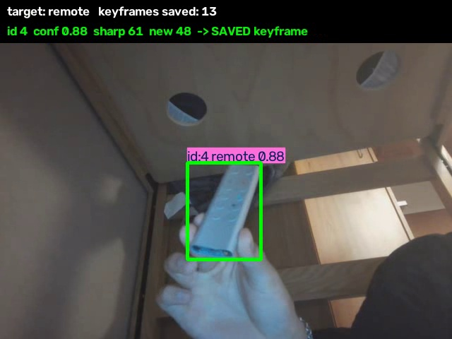
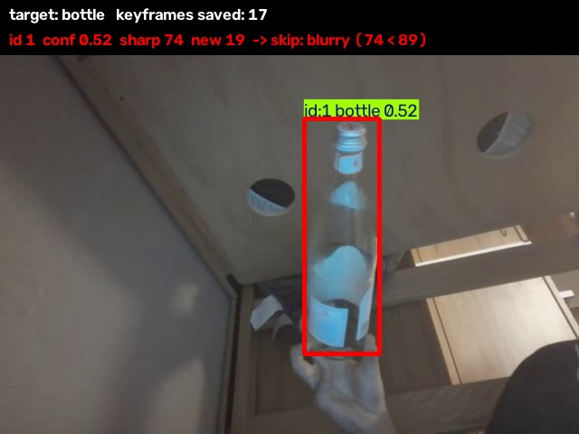
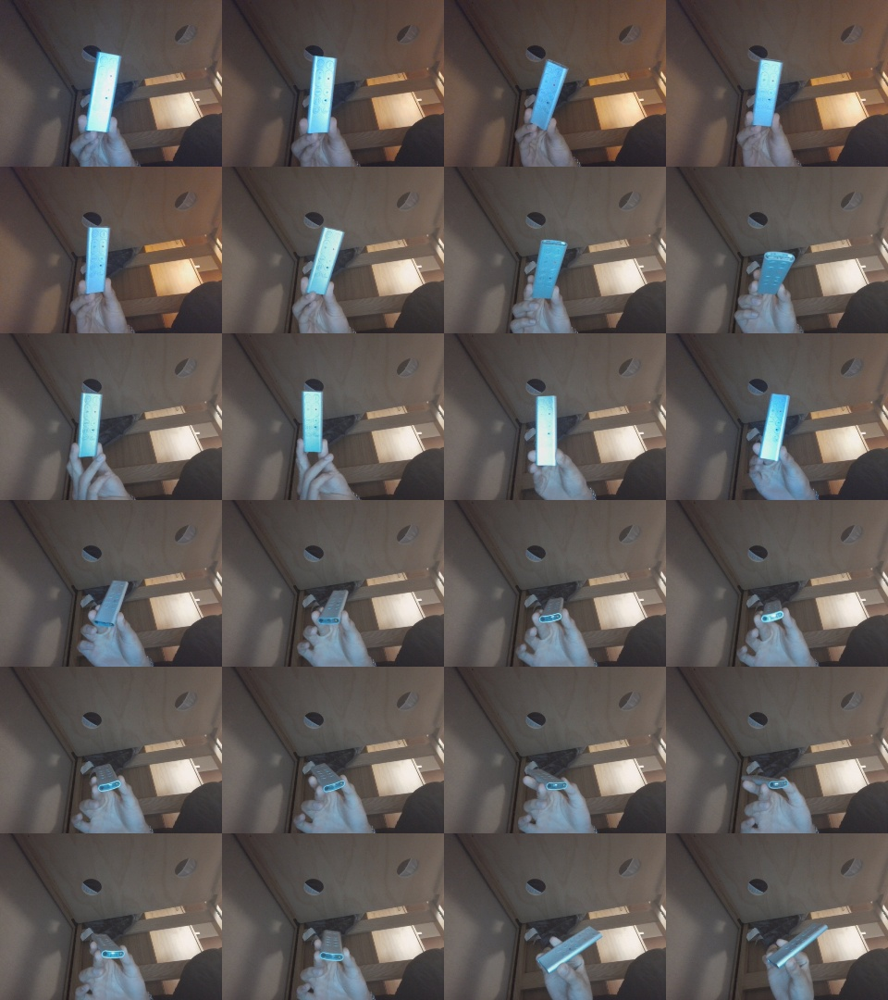
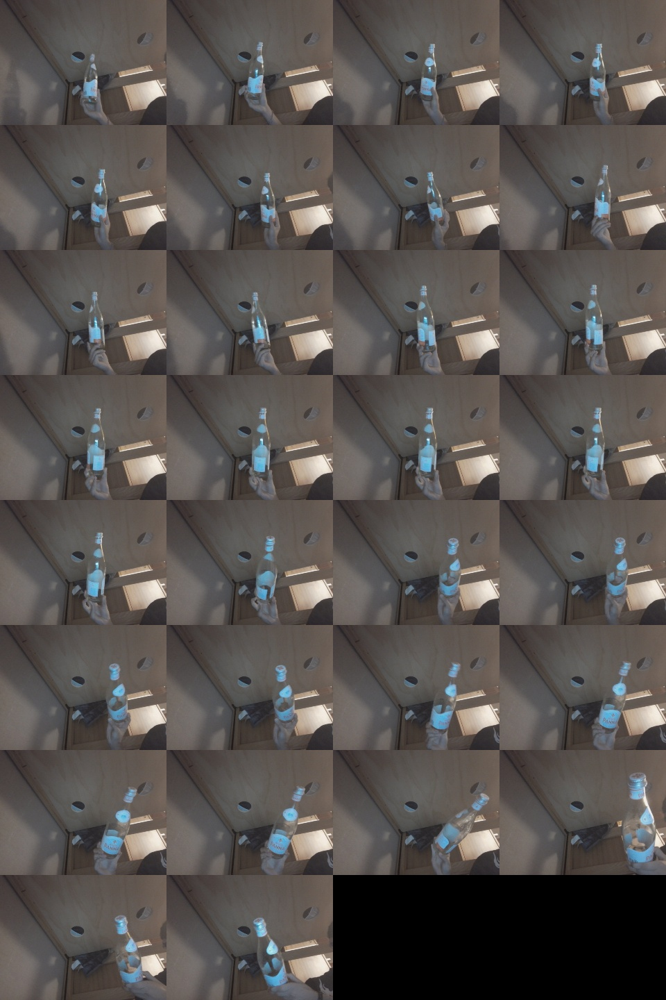
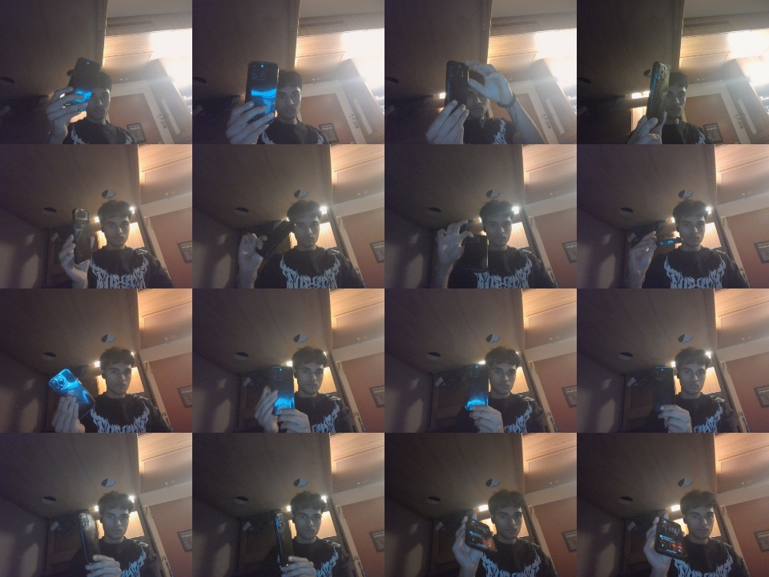

# Smart Keyframe Picker for 3D Reconstruction

A YOLO-based tool that watches a webcam or video, tracks one object, and automatically
saves only the frames that are useful for 3D reconstruction.

Photogrammetry and NeRF / Gaussian-splatting pipelines start the same way: walk around an
object with a phone, then pull frames out of the video. Taking every frame (or every Nth frame)
gives you hundreds of near-duplicates, blurry frames from camera shake, and frames where the
object is half out of view, all of which slow down or break reconstruction. This program uses
object detection to pick the good frames for you.

| saved: sharp, fully visible, new angle | rejected: blurry compared to recent frames |
|---|---|
|  |  |

Demo clip: [docs/remote_demo.mp4](docs/remote_demo.mp4)

## What it detects

Any of the 80 COCO classes that the pretrained YOLO model knows (cup, bottle, chair, person,
laptop, potted plant, ...). You choose one with `--target`. The default is `cup`.

## Model choice

**YOLO11n** (Ultralytics, pretrained on COCO):

- **Fast on a CPU.** The nano model runs in real time on a laptop with no GPU, which matters
  for a live webcam preview.
- **No training needed.** COCO already covers everyday objects people would want to scan.
- **Built-in tracking.** `model.track()` runs ByteTrack and gives each object a persistent ID,
  which I use to make sure every keyframe shows the *same* object.

A bigger model (yolo11s/m) would be more accurate but slower. For this task, detection only
needs to be "good enough" to locate the object; the quality checks do the real filtering.

## How it works

```
video/webcam frame
      │
      ▼
YOLO11n detect + track (target class only)
      │
      ├── nothing found ──► log "no_detection", show status, continue
      │
      ▼
pick the object to follow (stay locked on the same track ID)
      │
      ▼
crop the object and run 3 checks, in order:
  1. fully visible?  box isn't within --margin px of the frame edge
  2. sharp?          Laplacian variance ≥ --blur × median of the last 30 scores
  3. new viewpoint?  mean pixel difference vs. last saved crop ≥ --novelty
      │
      ├── any check fails ──► skip, show the reason on screen
      │
      ▼
save the clean frame to output/keyframes/
```

1. **Input.** OpenCV's `VideoCapture` reads frames from a webcam index (`0`) or a video file.
2. **Detection.** Each frame goes through `model.track(..., classes=[target_id], persist=True)`.
   `classes` filters to the target object; `persist=True` keeps track IDs across frames.
3. **Choosing the object.** If the object we were following is still visible, we keep
   following its ID. Otherwise we switch to the most confident detection.
4. **Custom behavior (the 3 checks).**
   - *Fully visible:* reconstruction can't recover parts of the object that aren't in the image.
   - *Sharp:* the Laplacian filter responds to edges. A blurry image has weak edges, so the
     variance of the Laplacian is low. Raw scores depend heavily on the camera and the object's
     texture, though: on my webcam, a smooth orange scored about 34 even when in focus, while a
     textured bottle scored about 112. My first version used a fixed cutoff of 100 and saved
     **zero** frames of the orange. So "blurry" is now judged relative to the object itself: a
     frame passes if its score is at least 80% of the median of the last 30 scores. The median
     ignores the occasional very blurry frame, and the 30-frame window adapts if the lighting or
     distance changes. The first 10 detections are used to learn the baseline and are not saved.
   - *New viewpoint:* both crops are resized to 64×64 grayscale and compared pixel by pixel.
     Small difference means the camera barely moved, so the frame adds no new information.
5. **Output.**
   - Live window with YOLO's boxes, the followed object highlighted (green = saved,
     red = cut off or blurry, yellow = duplicate view, light blue = still learning sharpness),
     and a status bar showing the scores and the decision.
   - `output/keyframes/keyframe_001.jpg ...` contains the clean frames, ready for COLMAP / Meshroom / etc.
   - `output/log.csv` has one row per frame: track ID, confidence, sharpness, novelty, decision.
   - `output/summary.jpg` is a contact sheet of every saved keyframe.
   - `output/annotated.mp4` is the annotated video (with `--save-video`).

**No detections:** when YOLO finds nothing, `result.boxes` is empty, `pick_target` returns
`None`, and the frame is logged as `no_detection`. The loop keeps going.

## Install

Tested with Python 3.14 on Windows (CPU only).

```bash
git clone <this repo>
cd <repo folder>
python -m venv .venv            # on Windows, `py -3.14 -m venv .venv` also works
.venv\Scripts\activate          # Windows
# source .venv/bin/activate     # macOS / Linux
pip install -r requirements.txt
```

The `yolo11n.pt` weights (about 5 MB) download automatically on the first run.

`torch` and `torchvision` are pinned to 2.13 / 0.28 because the newest pair (2.14 / 0.29)
fails on Python 3.14 with `operator torchvision::nms does not exist`.

## Run

```bash
# live webcam, capture a remote, save the annotated video (how the samples below were made)
python keyframe_picker.py --source 0 --target remote --save-video --out output/remote

# class names with spaces need quotes
python keyframe_picker.py --source 0 --target "cell phone" --out output/phone

# recorded video, capture a chair, also save the annotated video
python keyframe_picker.py --source videos/chair.mp4 --target chair --save-video

# no preview window (e.g. on a server)
python keyframe_picker.py --source videos/bottle.mp4 --target bottle --no-show
```

Press `q` to stop early. All options:

| flag | default | meaning |
|---|---|---|
| `--source` | `0` | webcam index or video path |
| `--target` | `cup` | COCO class name to capture |
| `--model` | `yolo11n.pt` | YOLO weights |
| `--conf` | `0.4` | minimum detection confidence |
| `--margin` | `10` | px the box must stay from the frame edge |
| `--blur` | `0.8` | minimum sharpness, as a fraction of the object's recent median |
| `--novelty` | `20` | minimum difference from the last saved view |
| `--out` | `output` | output folder |
| `--save-video` | off | save `annotated.mp4` |
| `--no-show` | off | don't open a window |

## Sample output

All three were recorded live on a laptop webcam (640×480, CPU only), holding the object and
rotating it. Each recording deliberately includes camera shake, moving the object partly out of
frame, pauses, and moments with the object fully out of view.

| target | frames | no detection | cut off | blurry | same view | **keyframes saved** |
|---|---|---|---|---|---|---|
| remote | 496 | 278 | 0 | 52 | 133 | **24** |
| bottle | 615 | 284 | 12 | 57 | 223 | **30** |
| cell phone* | 1478 | 1178 | 25 | 204 | 55 | **16** |

\*The cell phone run was recorded with the first version of the blur check (a fixed cutoff of
100), so more of its frames were rejected as blurry. The other two use the relative check.

For the remote and bottle, about 1 in 20 frames became a keyframe. Every rejected frame is
logged with its reason in `log.csv`.

**Remote:** 24 keyframes covering the front, the angled sides, and both ends


**Bottle:** 30 keyframes, upright, tilted, label turned in different directions


**Cell phone:** 16 keyframes, front, back, and edge-on


## Limitations and improvements

- **Novelty is 2D, not true viewpoint.** Pixel difference measures how different the crop
  *looks*, not how far the camera moved. I saw this with an orange: it looks the same from every
  side, so a full rotation produced 142 "same view" rejections and only 1 keyframe. It can also
  be fooled the other way, by lighting changes or a hand moving around the object. A better
  signal would be feature matching (ORB/SIFT) or estimated camera pose between frames.
- **Detection is the bottleneck for some objects.** Pretrained YOLO11n detected the remote,
  bottle and phone reliably, but struggled with a backpack and a computer mouse at close range.
  A larger model or a short fine-tune on the target object would help.
- **Only COCO classes.** Objects outside the 80 classes need a fine-tuned model or an
  open-vocabulary detector such as YOLO-World.
- **Boxes include background.** Using a segmentation model (`yolo11n-seg`) would let us save
  object masks too, which many reconstruction tools use to ignore the background.
- **Relative blur has a blind spot.** If the *entire* recording is blurry, the median is low
  too, so blurry frames still pass. Combining the relative rule with a small absolute floor
  would catch that. The novelty threshold is still fixed and could be made adaptive the same way.
- **Tracking ID switches.** If the object leaves the frame and comes back, it may get a new ID.
  The program then follows whatever is most confident, which is fine for single-object scans
  but could mix objects in a cluttered scene.
- **Next step toward the full pipeline:** feed `output/keyframes/` into COLMAP to get a point
  cloud, then voxelize and map voxel colors to Minecraft blocks.
